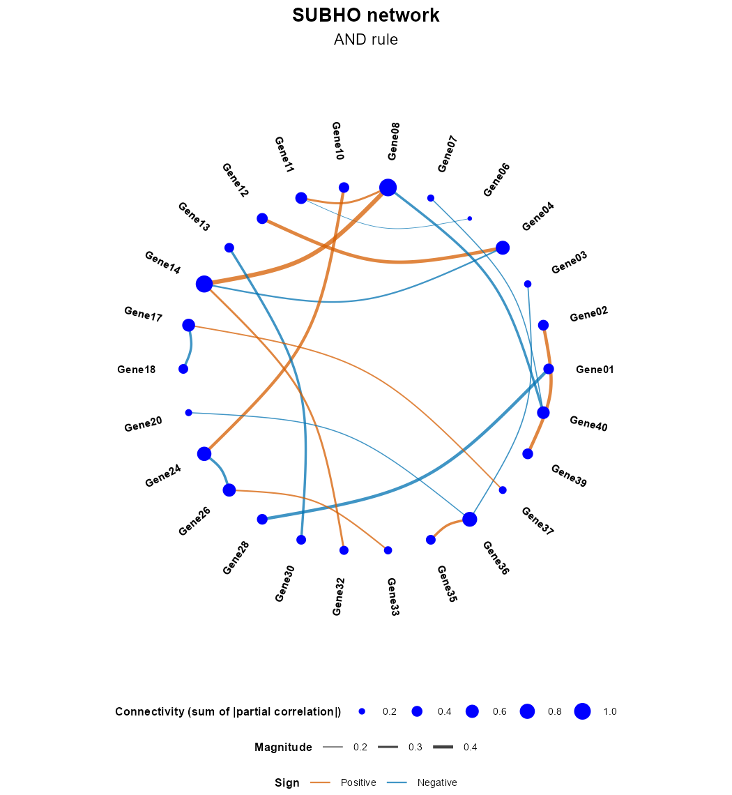
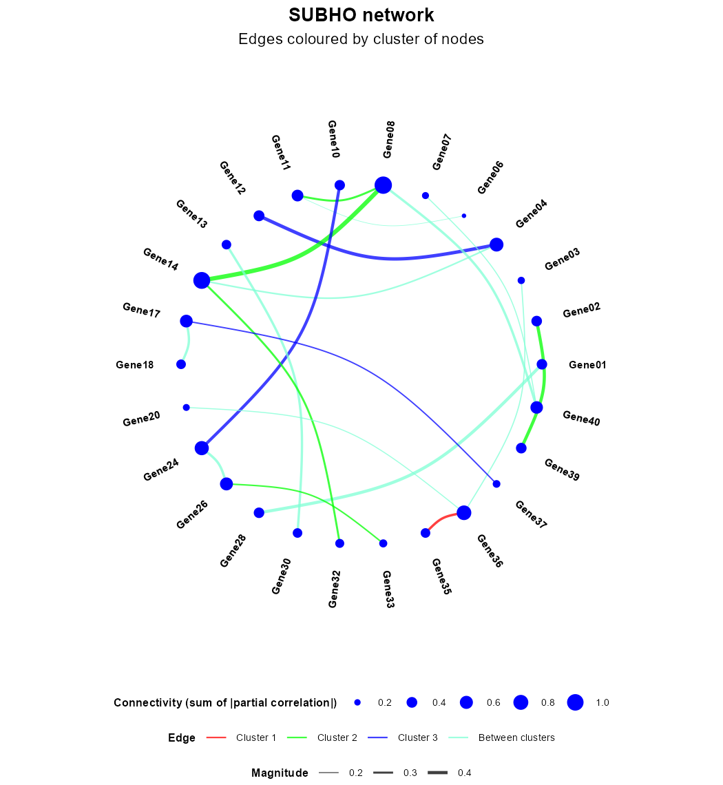
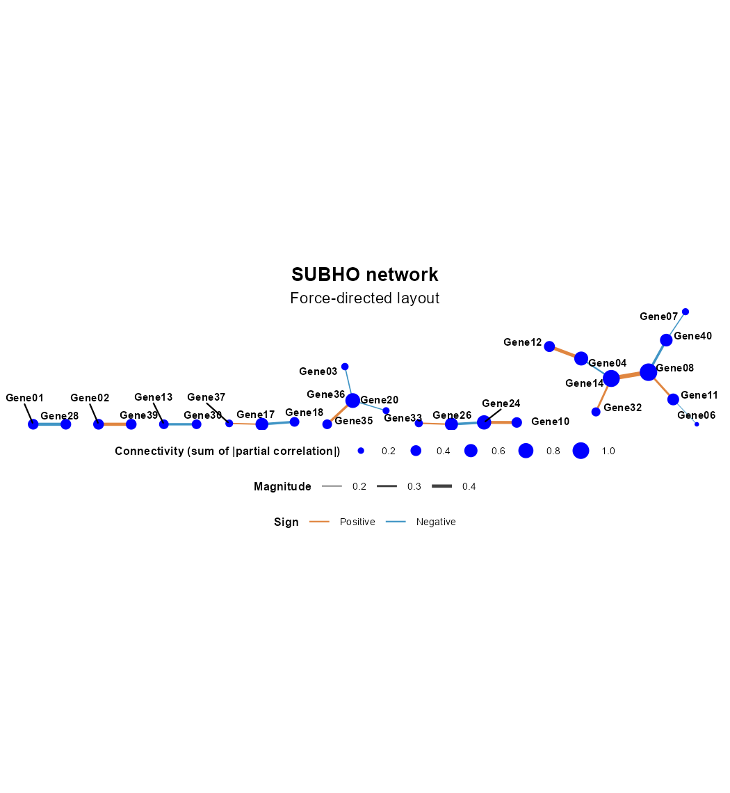
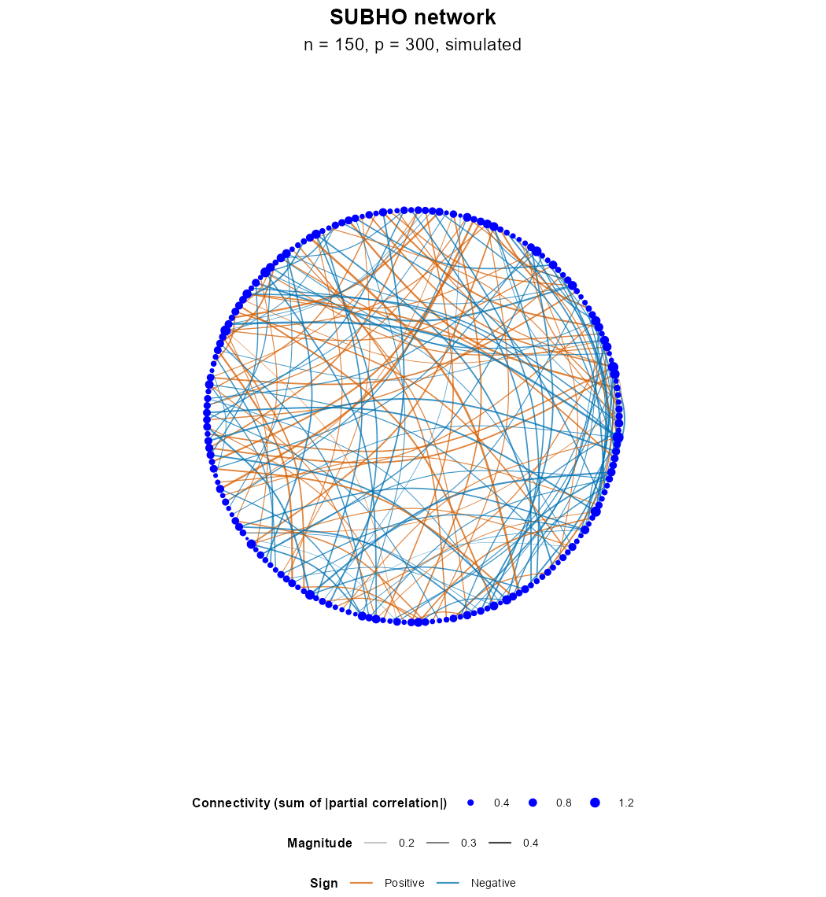
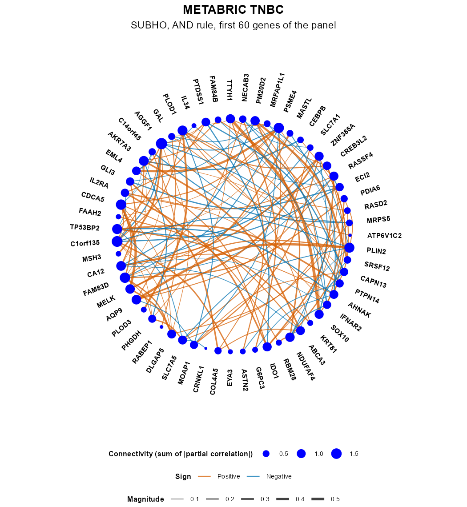
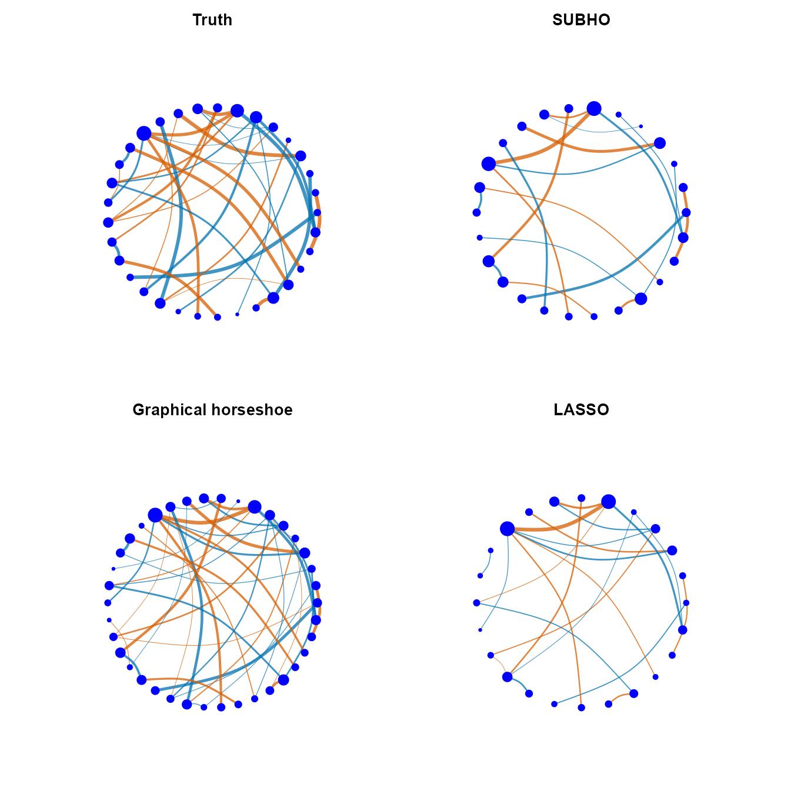

# GGMsubho

**Sparse network estimation from high-dimensional continuous data with Graphical-SUBHO
(Step-Up Bayesian HOrseshoe).**

GGMsubho estimates a *conditional dependence network*, or Gaussian graphical model, from a
data matrix. Two variables share an edge when they are still associated after accounting for
all the other variables. The package is designed for the common case of few samples, many
variables, and a network in which most pairs are not connected.

The method is described in:

> Bhadury S, Mitra R, Gaskins JT (2023). *Fast Bayesian High-Dimensional Gaussian Graphical
> Model Estimation.* [arXiv:2308.02713](https://arxiv.org/abs/2308.02713).

<p align="center"></p>

## Contents

- [How SUBHO works](#how-subho-works)
- [Installation](#installation)
- [Quick start](#quick-start)
- [Step by step: from data to a network figure](#step-by-step-from-data-to-a-network-figure)
- [Using your own data](#using-your-own-data)
- [The TNBC gene panel](#the-tnbc-gene-panel)
- [Comparison methods, including the graphical horseshoe](#comparison-methods-including-the-graphical-horseshoe)
- [Run time and parallel computing](#run-time-and-parallel-computing)
- [Functions](#functions)
- [Citation](#citation)

## How SUBHO works

Under a Gaussian graphical model, the edges of node $a$ are the non-zero coefficients in the
regression of $X_a$ on all the other variables. For each node, SUBHO:

1. **Shrinks.** Fits that regression with a [horseshoe prior](https://doi.org/10.1093/biomet/asq017).
2. **Ranks.** Orders the predictors by the size of their posterior coefficient.
3. **Selects.** Scores the $K+1$ nested models containing the top $k$ predictors,
   $k = 0, \ldots, K$, by a conjugate working marginal likelihood times a Beta-Bernoulli model
   prior, and keeps the best one. This replaces a search over $2^{p-1}$ models.

The neighbourhoods are then combined by the **AND** rule (both nodes select each other) or the
**OR** rule (either one does), and partial correlations follow from

$$\hat\psi_{ab} = \mathrm{sign}(\hat\beta_a^{(b)})\sqrt{\hat\beta_a^{(b)}\hat\beta_b^{(a)}},$$

set to zero when the two coefficients disagree in sign.

## Installation

```r
# install.packages("remotes")
remotes::install_github("sagnikbhadury/GGMsubho", build_vignettes = TRUE)
```

The package contains compiled code, so installing from GitHub needs a C++ toolchain
([Rtools](https://cran.r-project.org/bin/windows/Rtools/) on Windows, Xcode command line tools
on macOS). The comparison methods that rely on other packages, and the panel figures, use
optional packages:

```r
install.packages(c("BAS", "BDgraph", "CVglasso", "patchwork", "pROC", "projpred", "rstanarm"))
```

## Quick start

```r
library(GGMsubho)

sim <- simulate_ggm(n = 120, p = 40, structure = "random", edge_prob = 0.06, seed = 2026)
fit <- subho(sim$data, seed = 1)
plot_network(fit)
```

## Step by step: from data to a network figure

The numbers and figures below come from simulated data, so the true network is known. They
are reproduced by `tools/make_readme_figures.R` in the source of this repository.

### 1. Prepare the data

`subho()` takes a numeric matrix or data frame with **samples in rows and variables in
columns**, without missing values. Column names become node names.

```r
sim <- simulate_ggm(n = 120, p = 40, structure = "random", edge_prob = 0.06,
                    node_names = sprintf("Gene%02d", 1:40), seed = 2026)
dim(sim$data)
#> [1] 120  40
```

This network has 35 true edges among the 780 possible pairs, with absolute partial
correlations between 0.20 and 0.39.

### 2. Estimate the network

```r
fit <- subho(sim$data, seed = 1)
fit
#> SUBHO network: 40 nodes, 120 samples
#> Edges: 19 (AND rule), 26 (OR rule)
```

The columns are centred and scaled by default. The defaults are those of the original
analyses: 2,000 Gibbs iterations, a burn-in of 200, and a thinning of 10 at each node.

### 3. Inspect the result

```r
summary(fit, rule = "and")
#>   method nodes samples edges density positive negative median_abs_psi isolated_nodes max_degree
#> 1  SUBHO    40     120    19   0.024        9       10          0.327             14          3
```

| Element | Meaning |
|---|---|
| `fit$graph_and`, `fit$graph_or` | Symmetric 0/1 adjacency matrices |
| `fit$psi` | Partial correlations from the shrunken coefficients. They are non-zero outside the graph too; `fit$psi * fit$graph_and` restricts them |
| `fit$gamma` | Directed selections, before the AND or OR rule. `gamma[a, b] = 1` means $X_b$ was selected for response $X_a$ |
| `fit$beta` | Horseshoe coefficients. `beta[a, b]` is the coefficient of $X_b$ when $X_a$ is the response |
| `fit$neighbourhood_size` | Number of predictors selected at each node |

The edges and nodes are available as tables, and as an `igraph` object for further analysis:

```r
net <- network_data(fit, rule = "and")
head(net$edges, 3)
#>     from     to partial_correlation
#> 1 Gene06 Gene11              -0.178
#> 2 Gene08 Gene11               0.299
#> 3 Gene04 Gene12               0.414

top_connected(fit, top = 3)     # by degree, ties broken by the sum of |partial correlation|
#>     node degree strength
#> 1 Gene14      3    1.509
#> 2 Gene08      3    1.216
#> 3 Gene36      3    0.842
```

Since this example is simulated, the estimate can be scored against the truth:

```r
graph_metrics(fit$graph_and, sim$graph)[c("edges", "fdr", "tpr", "mcc")]
#>  edges    fdr    tpr    mcc
#> 19.000  0.000  0.543  0.729
```

### 4. Draw the network

`plot_network()` returns a `ggplot` object, so it can be changed with `+` and saved with
`ggsave()`.

```r
p <- plot_network(fit, rule = "and", subtitle = "AND rule")
ggplot2::ggsave("network.png", p, width = 7, height = 7.6, dpi = 300, bg = "white")
```

- **Edge colour** is the sign of the partial correlation.
- **Edge width** is its magnitude.
- **Node size** is the sum of absolute partial correlations at the node.
- **Isolated nodes** are left out unless `keep_isolated = TRUE`.

#### Colouring edges by groups of nodes

Give any grouping of the nodes, for example pathways or the clusters from `cluster_nodes()`.
Edges inside a group take its colour, and edges between groups share one colour.

```r
clusters <- cluster_nodes(sim$data, k = 4)
plot_network(fit, clusters = clusters)
```

<p align="center"></p>

#### Other layouts and larger networks

`layout` accepts the layouts of [`ggraph`](https://ggraph.data-imaginist.com/), and
`curvature = 0` draws straight edges. For hundreds of nodes, turn off the labels and use finer
marks.

```r
plot_network(fit, layout = "stress", curvature = 0)

big <- simulate_ggm(n = 150, p = 300, structure = "random", edge_prob = 0.01, seed = 7)
fit_big <- subho(big$data, cores = 6, seed = 2)
plot_network(fit_big, show_labels = FALSE, node_size_range = c(0.3, 2.5),
             edge_width_range = c(0.1, 0.6))
```

<p align="center">


</p>

The 300-node network has more variables than samples. There, SUBHO reported 162 AND edges with
an FDR of 0.006 and a TPR of 0.349 against 461 true edges.

#### Matrix view

```r
plot_matrix(fit, rule = "and")
```

## Using your own data

```r
x <- read.csv("my_expression.csv", row.names = 1)   # samples in rows, variables in columns
fit <- subho(x, cores = 4, seed = 1)
plot_network(fit, rule = "and", title = "My network")
write.csv(network_data(fit)$edges, "edges.csv", row.names = FALSE)
```

- **Transform first.** The model is Gaussian, so skewed measurements should be put on a suitable
  scale, such as logs, before fitting.
- **Data with many zeros.** Zero-inflated measurements, such as raw counts, break the Gaussian
  assumption. Transform them with a method suited to your assay, and treat the network as
  approximate. The package does not model excess zeros.
- **Missing values.** `subho()` stops if it finds any. Handle them beforehand.
- **Constant columns.** `subho()` stops if it finds any. Remove them.
- **AND or OR?** AND is the stricter rule and OR gives denser graphs.
- **`estimator`.** `"median"` (the default) ranks and estimates with the posterior median, and
  `"mean"` with the posterior mean.
- **`K`.** The largest neighbourhood considered. The default evaluates the whole path. Setting
  `K` to a smaller value saves time when neighbourhoods are known to be small.
- **Precision matrix.** `precision_estimate(fit)` gives a plug-in estimate, which is not
  guaranteed to be positive definite. `plot_network()` also accepts your own matrix, of partial
  correlations by default, or a precision matrix with `type = "precision"`.

An estimated edge is an association conditional on the variables in the data. It does not show
causation, and unmeasured variables can create or hide edges.

## The TNBC gene panel

`tnbc_metabric` holds the processed panel used in the data application of the article: mRNA
Z-scores for **299 triple-negative breast cancer patients and 1,000 genes** from the
[METABRIC study on cBioPortal](https://www.cbioportal.org/study/summary?id=brca_metabric). Sample
identifiers are not included.

```r
dim(tnbc_metabric)
#> [1]  299 1000

# An illustration on the first 60 columns of the panel
fit_tnbc <- subho(tnbc_metabric[, 1:60], cores = 6, seed = 1)
fit_tnbc
#> SUBHO network: 60 nodes, 299 samples
#> Edges: 134 (AND rule), 239 (OR rule)
plot_network(fit_tnbc, title = "METABRIC TNBC", subtitle = "SUBHO, AND rule, first 60 genes of the panel")
```

<p align="center"></p>

The first 60 columns are only an illustration, not a chosen biological gene set. The figure
therefore should not be read as a biological result.

**Please cite the source of these data.** They are shared under the
[ODC Open Database License](https://opendatacommons.org/licenses/odbl/1-0/), as stated by
cBioPortal, and attribution to the original studies is required:

- Curtis C, et al. (2012). The genomic and transcriptomic architecture of 2,000 breast tumours
  reveals novel subgroups. *Nature* 486, 346-352.
  [doi:10.1038/nature10983](https://doi.org/10.1038/nature10983)
- Pereira B, et al. (2016). The somatic mutation profiles of 2,433 breast cancers refine their
  genomic and transcriptomic landscapes. *Nature Communications* 7, 11479.
  [doi:10.1038/ncomms11479](https://doi.org/10.1038/ncomms11479)
- Rueda OM, et al. (2019). Dynamics of breast-cancer relapse reveal late-recurring ER-positive
  genomic subgroups. *Nature* 567, 399-404.
  [doi:10.1038/s41586-019-1007-8](https://doi.org/10.1038/s41586-019-1007-8)
- Cerami E, et al. (2012). The cBio cancer genomics portal. *Cancer Discovery* 2, 401-404.
  [doi:10.1158/2159-8290.CD-12-0095](https://doi.org/10.1158/2159-8290.CD-12-0095)
- Gao J, et al. (2013). Integrative analysis of complex cancer genomics and clinical profiles
  using the cBioPortal. *Science Signaling* 6, pl1.
  [doi:10.1126/scisignal.2004088](https://doi.org/10.1126/scisignal.2004088)
- de Bruijn I, et al. (2023). Analysis and visualization of longitudinal genomic and clinical
  data from the AACR Project GENIE Biopharma Collaborative in cBioPortal. *Cancer Research* 83,
  3861-3867. [doi:10.1158/0008-5472.CAN-23-0816](https://doi.org/10.1158/0008-5472.CAN-23-0816)

## Comparison methods, including the graphical horseshoe

Every estimator below returns the same kind of object, so `plot_network()`, `graph_metrics()`,
`summary()` and `top_connected()` work on all of them.

| Function | Method | Extra package |
|---|---|---|
| `subho()` | Graphical-SUBHO (Bhadury, Mitra and Gaskins 2023) | |
| `ghs_ggm()` | Graphical horseshoe (Li, Craig and Bhadra 2019) | |
| `basad_ggm()` | Neighbourhood selection with BASAD priors (Narisetty and He 2014) | |
| `lasso_ggm()` | Neighbourhood selection with the lasso (Meinshausen and Buhlmann 2006) | |
| `iw_ggm()` | Inverse Wishart with credible intervals | |
| `glasso_ggm()` | Graphical lasso (Friedman, Hastie and Tibshirani 2008) | CVglasso |
| `bdgraph_ggm()` | G-Wishart with birth-death MCMC (Mohammadi and Wit 2019) | BDgraph |
| `bas_ggm()` | Neighbourhood selection with a hyper-g prior (Liang et al. 2008) | BAS |
| `projpred_ggm()` | Projection predictive selection (Williams et al. 2018) | rstanarm, projpred |

The graphical horseshoe places a horseshoe prior directly on the off-diagonal entries of the
precision matrix, and keeps an edge when the 50% credible interval excludes zero:

```r
fits <- list(SUBHO = fit,
             `Graphical horseshoe` = ghs_ggm(sim$data, seed = 1),
             LASSO = lasso_ggm(sim$data, cores = 6, seed = 1))

plot_network_panels(c(list(Truth = sim$partial_cor), fits), ncol = 2)
```

<p align="center"></p>

On this one simulated data set (the graphs use the AND rule where it applies):

| Method | Edges (true: 35) | FDR | TPR | MCC | Seconds |
|---|---:|---:|---:|---:|---:|
| SUBHO (6 cores) | 19 | 0.000 | 0.543 | 0.729 | 2.0 |
| Graphical horseshoe (1 core) | 42 | 0.286 | 0.857 | 0.771 | 14.9 |
| LASSO (6 cores) | 22 | 0.091 | 0.571 | 0.711 | 2.1 |

A single data set does not establish how the methods rank in general; see the article for the
simulation study. To compare the hubs that different methods find:

```r
plot_top_overlap(top_overlap(fits, top = 10))
```

## Run time and parallel computing

`subho()` runs one regression per node, so the nodes can run in parallel:

```r
fit <- subho(x, cores = 6, seed = 1)
```

Each node has its own seed, so **a fit with a given `seed` is identical for any number of
cores**. With `cores > 1`, keep a multi-threaded BLAS to one thread so that it does not compete
with the workers.

Times measured on one Windows laptop at the default settings, on 6 cores unless noted:

| Data | Time |
|---|---|
| n = 120, p = 40 | about 2 seconds |
| n = 75, p = 150 | about 30 seconds |
| n = 150, p = 300 | about 5 minutes |
| n = 299, p = 1000 | about 80 seconds per node on one core, so an estimated 4 hours on 6 cores |

The last figure is projected from 200 iterations at one node, not from a complete fit. Evaluating
the full step-up path for one node at p = 1000 takes about 0.5 seconds.

## Functions

| Purpose | Functions |
|---|---|
| Estimate a network | `subho()`, and the methods in the table above |
| Building blocks | `horseshoe_regression()`, `credible_beta()`, `step_up_select()`, `log_marginal_working()`, `symmetrize_graph()`, `partial_correlation()`, `precision_estimate()`, `ggm_graph()` |
| Draw networks | `plot_network()`, `plot_network_panels()`, `plot_matrix()`, `plot_top_overlap()` |
| Network tables | `network_data()`, `top_connected()`, `top_overlap()`, `cluster_nodes()` |
| Simulate | `simulate_ggm()`, `true_beta()`, `basad_start_q()` |
| Score against a known graph | `graph_metrics()`, `partial_cor_error()`, `top_edge_metrics()`, `edge_auc()`, `correlation_summary()` |
| Data | `tnbc_metabric` |

The vignette walks through the same analysis: `vignette("network-workflow", package = "GGMsubho")`.

## Citation

If you use GGMsubho, please cite:

> Bhadury S, Mitra R, Gaskins JT (2023). Fast Bayesian High-Dimensional Gaussian Graphical Model
> Estimation. arXiv:2308.02713. <https://arxiv.org/abs/2308.02713>

```bibtex
@misc{bhadury2023fast,
  title         = {Fast Bayesian High-Dimensional Gaussian Graphical Model Estimation},
  author        = {Bhadury, Sagnik and Mitra, Riten and Gaskins, Jeremy T.},
  year          = {2023},
  eprint        = {2308.02713},
  archivePrefix = {arXiv},
  primaryClass  = {stat.ME},
  doi           = {10.48550/arXiv.2308.02713}
}
```

`citation("GGMsubho")` prints the same reference.

## License

The code is under the MIT license. The `tnbc_metabric` data are under the ODC Open Database
License; see [`inst/COPYRIGHTS`](inst/COPYRIGHTS).
